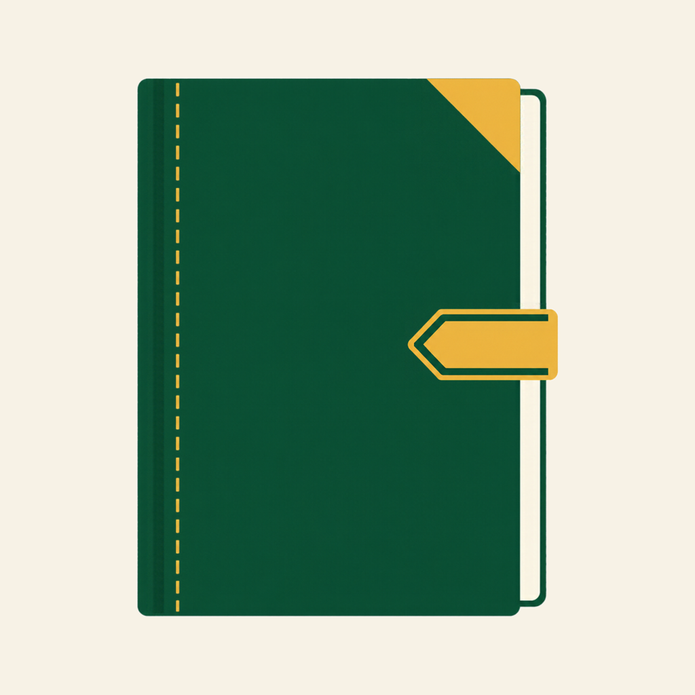

<p align="center"></p>

# Daftar

A private, offline-first notes and checklists app for Android, with a matching Windows desktop app. Your notes live on your device, and sync between devices through **your own** free [Turso](https://turso.tech) database. Nobody else holds your data.

Built as a replacement for ColorNote, and it can import a ColorNote backup.

## What it does

- **Notes and checklists**, laid out like a timetable: each note is a dated row with a colour band. Lists show their progress.
- **Drag to reorder** checklist items; tick items straight from a **home-screen widget**.
- **9 colours and tags.** Name a colour (long-press it) so you remember what it means.
- **Calendar view**: give a note a date and see it on the month. Daftar can spot dates mentioned in a note and offer to add them.
- **Calendar events with reminders**, added to your phone's Google Calendar. They aren't stored as notes.
- **Real locked notes**: encrypted with AES-256 using a key from your passphrase, on the device *and* in the cloud copy. A fingerprint unlocks them day to day.
- **Formatting** (headings, bold, lists, quotes, highlight), switched on per note.
- **Arabic and English** side by side, with right-to-left text handled per note and per line. Optional Hijri date.
- **Themes**: light or dark, four colour themes, pure black, text size, row height, list style and sort order.
- **Backup**: export everything to one file (locked notes stay encrypted inside it) and restore it on any device.
- **Sync clashes never lose work**: if a note was edited on two devices while apart, Daftar merges lists and keeps the other version of a note as a "(conflict copy)".

## Install

### Android

Build the APK yourself (below). Or, if the repo has a release, download `daftar.apk` from the Releases page, open it on your phone and allow installing from that source.

### Windows desktop

Run `scripts\build-desktop.ps1` to make an installer in `desktop\release\`. The desktop app shares the same database through Turso. It has no fingerprint, so locked notes always ask for your passphrase there.

## Set up sync (free)

1. Make a free account at [turso.tech](https://turso.tech) and create a database (any name, any region near you).
2. In the Turso dashboard, copy the database **URL** and create an **auth token** for it.
3. In Daftar, open **Settings → Sync with Turso**, paste both, and tap **Connect**.

Do the same on each device with the same URL and token. Turso's free plan is far larger than a notes app needs; check [turso.tech/pricing](https://turso.tech/pricing) for the current limits. The token stays in the device's secure storage and is only ever sent to Turso.

**Lock first, then sync:** if you use locked notes, set your lock passphrase in **Settings → Lock** on your first device. Other devices unlock with the same passphrase. It can't be recovered if you forget it.

## Build it yourself

Needs Node.js 20+, Android Studio (SDK, and CMake 3.31 from the SDK Manager), and a phone with USB debugging on.

```powershell
npm install
.\scripts\build-apk.ps1 -Clean -Install
```

On Windows the script builds from a short folder (`C:\dt`) to avoid the 260-character path limit in the Android C++ build.

### Over-the-air updates (optional)

To push app changes to your phones without reinstalling:

1. Make a free account at [expo.dev](https://expo.dev) and run `npx eas-cli login`, then `npx eas-cli init`.
2. Copy `daftar.local.example.json` to `daftar.local.json` and fill in your Expo username, project ID and `https://u.expo.dev/<project id>`. This file is never committed.
3. Build and install once. After that, run `.\scripts\publish-update.ps1 "what changed"` to send updates.

Changes to native parts (permissions, widgets, new native packages) still need a new APK.

### Import from ColorNote

Daftar imports the JSON made by decrypting a ColorNote `.backup` file: **Settings → Backup and import → Import from ColorNote**. Delete the JSON from your phone afterwards, because it holds your notes unencrypted.

## Privacy

- No accounts, analytics or ads. Daftar only talks to your own Turso database, and to Expo's update service if you set up OTA updates.
- Locked notes are encrypted before they're saved or synced. Only their titles are stored as plain text, so the list can show them.
- The repo never contains anyone's notes, tokens or account details.

## Tech

Expo SDK 58 / React Native, expo-router, expo-sqlite, Turso's HTTP API, Electron for desktop.
